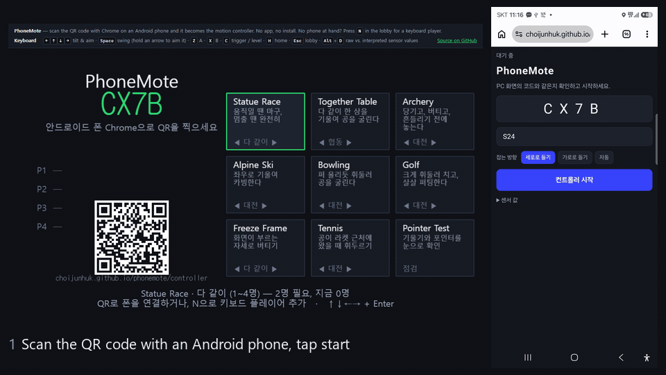
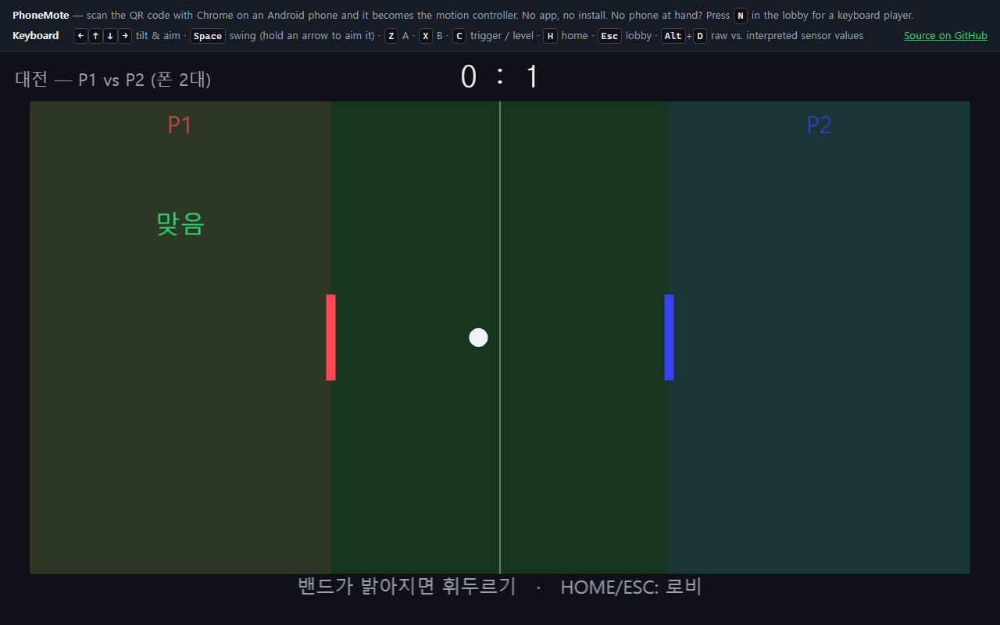
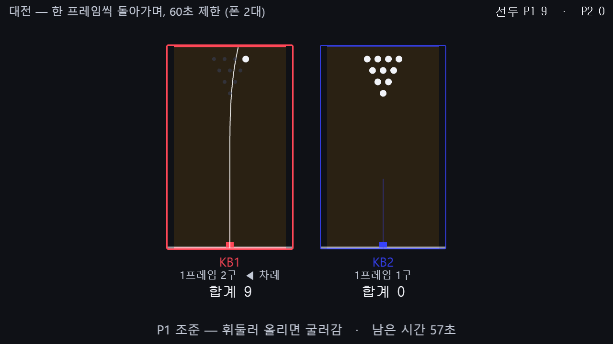
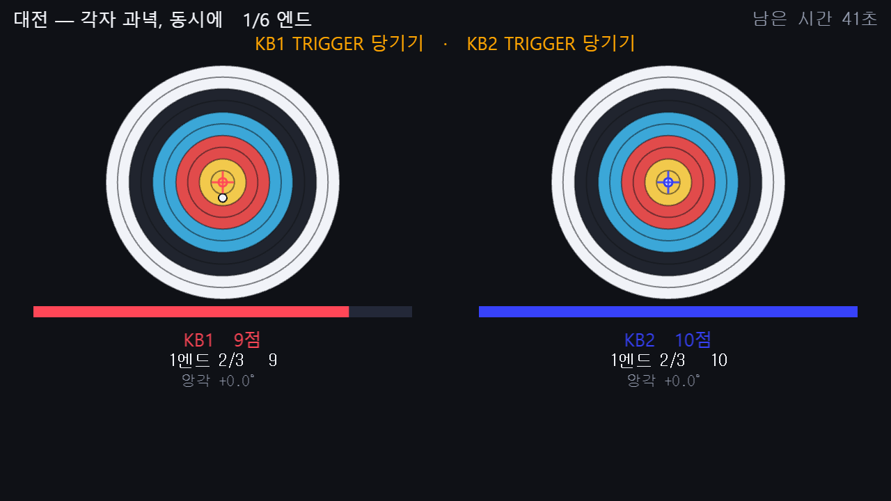
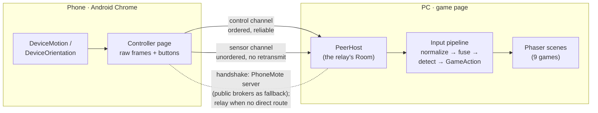

# PhoneMote

[](https://github.com/choijunhuk/phonemote/actions/workflows/ci.yml)
[](LICENSE)
[](https://choijunhuk.github.io/phonemote/)

**Turn an Android phone into a Wii-style motion controller for browser games. No app, no install.**

Open **[choijunhuk.github.io/phonemote](https://choijunhuk.github.io/phonemote/)** on a PC and
scan the QR code with Chrome on an Android phone. The phone's gyroscope and accelerometer stream
to the game over a direct WebRTC connection, and you swing, tilt and aim it like a Wii Remote.
No phone at hand? Press <kbd>N</kbd> in the lobby for a keyboard player that synthesizes the same
raw sensor frames.



<sub>A real Galaxy S24 joining over WebRTC in 3.2 s. The games after it are played by keyboard
stand-ins, which send the same raw sensor frames a phone does.</sub>

| Tennis | Bowling | Archery |
|---|---|---|
|  |  |  |

## How it works



- **The phone knows nothing about the game.** It sends raw sensor frames (68 bytes, little-endian
  `Float32Array`) and button state. Every interpretation happens on the PC, so a game can be
  developed and tested without a phone.
- **Scenes never see sensor data.** They consume `GameAction`s only (`swing`, `tilt`, `pose`,
  `stillness`, …). An ESLint rule enforces the boundary.
- **Two ways to connect.** The web build hosts the room in the game page and lets phones join over
  WebRTC, with nothing to install, falling back to a relay through the PhoneMote server when no
  direct route exists. The LAN build runs a small Node relay over HTTPS/WSS for networks
  without internet access. Both use the same `Room` rules from `packages/protocol`.

## Engineering notes

The design document, [ARCHITECTURE.md](ARCHITECTURE.md), records 64 decisions (D1–D64), most of
them settled by measuring a real phone rather than by reasoning. A few of them:

- **The sensor axes were measured, not assumed (D27).** Chrome's `rotationRate` did not follow the
  channel order in the spec. Correlating it against angular velocity derived from the orientation
  matrix gave 0.92 / 0.78 / 0.90 on the diagonal. Until then, a nod leaked into roll and the
  pointer's vertical axis was dead.
- **A test suite can pass for the wrong reason (D36).** The pointer clamped each time step to
  50 ms. Synthetic 60 Hz traces never hit the clamp (0 of 599 steps), but the real phone's median
  frame gap was 51–55 ms, so 39 of 39 steps were clamped and the cursor lagged the hand. Recorded
  traces from real phones now sit in the test corpus.
- **Ghost swings from a stalled sensor (D18, D19).** Android can stop delivering motion events while
  the page keeps sending its cached reading, so stream statistics looked perfect while integrators
  ran on dead data. Sending is now event-driven, and a per-event counter (`motionSeq`) detects a
  stall exactly instead of comparing values.
- **Swing detection without false triggers (D40).** A single threshold on angular speed fired on
  12 gestures that were not swings: laying the phone down, standing it up, tilting it. A Schmitt
  trigger with look-back and an acceleration veto took the 9 truly false ones to 0 without losing a
  real swing. The other 3 were genuine flicks at 828 °/s.
- **Serverless pairing that survives unreliable public infrastructure (D61).** No free signaling
  service was dependable on its own. The PeerJS cloud sits behind Cloudflare, split across origins
  that do not share state, and one public MQTT broker dropped a message in three. Rooms listen on
  every channel at once, phones call on all of them, duplicates are dropped, and a channel that
  connects late is replayed the last 15 s of messages. That took the first successful join from a
  15 s timeout plus a retry down to 6.5 s.
- **A relay that does TURN's job over one HTTPS port (D63).** Public signaling alone still left
  joins between 6.5 and 35 s, and a network without a direct route could not join at all. The
  PhoneMote server now carries the handshake first and, when WebRTC fails, tunnels the phone to the
  room page over a WebSocket on 443. Measured on a Galaxy S24: through the relay alone, joined in
  0.24 s at 60 Hz and 37 ms round trip.
- **The last 2.5 s of every join was a wait for nothing (D64).** Timing the phone's join step by
  step showed 2.6 s of a 3.2 s join spent "opening signaling", although the server's channel was
  open in 0.1 s: the fan-out waited for the slower brokers before calling. A room still needs that
  wait, to catch a taken code on any channel, but a phone does not, because late channels are
  replayed what was sent. Phones now call as soon as one channel is open, and a lookup only
  believes "no room" once the slower channels have answered too. Tap to joined went from 3.2–3.4 s
  to 0.7–1.3 s over seven runs on the same phone and network.
- **Every game is played in a real browser on every push (D57).** Playwright runs all nine games in
  every mode for 30 s of game time, plus phones joining over a real `RTCPeerConnection`. The game
  loop is stepped on a synthetic clock, so a run is deterministic and takes about 45 s. The build
  those tests played is the one that gets deployed.

## Games

| Game | Players | What it reads from the phone |
|---|---|---|
| **Bowling** | 1–4 | Stance from gravity, delivery speed from the swing, hook from the burst's yaw/roll ratio |
| **Golf** | 1–4 | Address and aim from gravity, power and club face from the swing, putts from the stroke's reversal |
| **Archery** | 1–4 | Elevation from gravity, yaw integrated while drawing, hand shake just before release |
| **Alpine Ski** | 1–4 | Edge angle from gravity alone, so a low sample rate does no harm |
| **Statue Race** | 1–4 | Angular speed only: shake to run, freeze on red |
| **Together Table** | 1–4 | Everyone's tilt averaged into one table: a co-op marble maze |
| **Freeze Frame** | 1–4 | Hold the pose the screen calls out, judged by the direction of gravity |
| **Tennis** | 1–2 | Swing speed and direction, timed to the ball |
| **Pointer Test** | 1–4 | Everything, as a tool for checking a phone |

Every game has a practice mode that shows the numbers behind the movement: hook ratio, backstroke
angle, hand shake. A player who cannot see what they did cannot fix it.

## Stack

TypeScript (strict, `noUncheckedIndexedAccess`, no `any`) · Phaser 3 · Vite · WebRTC data channels
· MQTT 3.1.1 and the PeerJS signaling protocol, both implemented directly · Node + `ws` for the LAN
relay and the PhoneMote server · Docker and nginx · Vitest (698 tests) · Playwright (31 end-to-end
tests) · GitHub Actions and GitHub Pages · pnpm workspaces

```
packages/protocol   wire format, binary codec, room rules (shared by relay and web host)
packages/peer       WebRTC links and signaling: the PhoneMote server, MQTT, PeerJS, fan-out
apps/game           the game: input pipeline, nine Phaser games, the web host
apps/controller     the page that runs on the phone
apps/server         the LAN relay, the PhoneMote server, trace recording and analysis tools
deploy/coms         the PhoneMote server's container and its one nginx location
traces/corpus       recorded and synthetic sensor traces used by the tests
```

## Running it

Node.js 22.13+ and pnpm.

```bash
pnpm install
pnpm web          # build the web version and serve it at http://localhost:4173
pnpm test         # unit tests
pnpm test:e2e     # build, then every game and phone pairing in a real browser
pnpm typecheck && pnpm lint
```

Opening `http://localhost:4173/?fake=2` gives two keyboard players straight away.
`?replay=real-swing.pmtrace` plays a recorded phone swing through the input pipeline.

The LAN version (`pnpm dev`) needs a locally trusted certificate on every phone. Setup is
described in Korean in [docs/SETUP.ko.md](docs/SETUP.ko.md).

## Limits

- **Android Chrome only** on the phone. iOS Safari's motion permission flow is deliberately out of
  scope.
- **Pairing and the fallback relay run on a small server** of my own (`coms.kw.ac.kr/phonemote`,
  one container: [deploy/coms](deploy/coms)). The free public brokers are kept as a fallback for
  signaling. Gameplay goes phone to PC directly when a route exists, and through the server's
  relay over 443 when it does not, which covers what a TURN server would.
- The game's interface is in Korean.

## License

[MIT](LICENSE)
